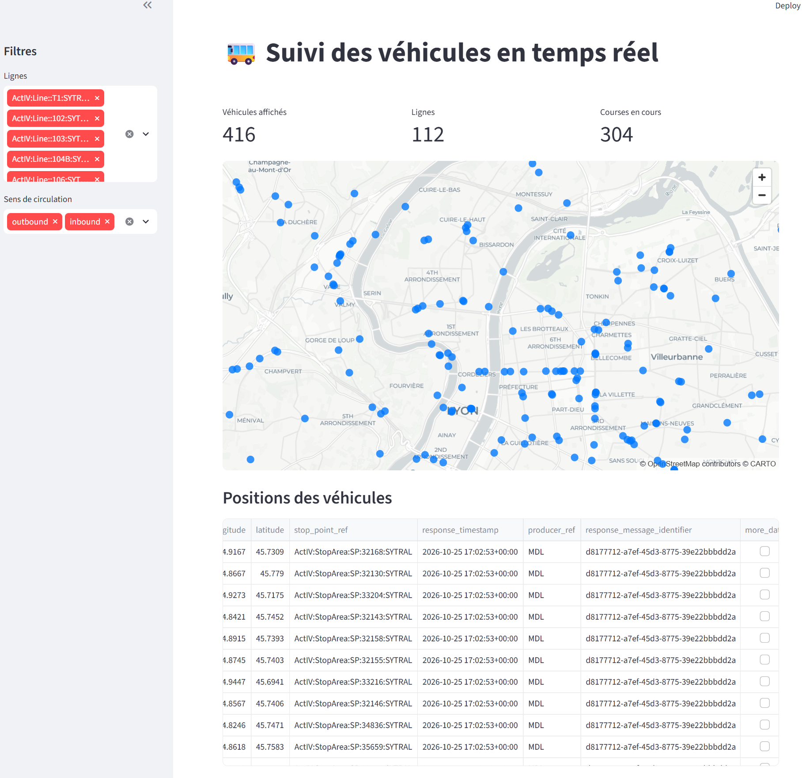

# Airflow Data Lyon

Projet local de collecte, transformation et exposition des données de mobilité de la Métropole de Lyon.

Le pipeline s'appuie sur Airflow pour orchestrer l'ingestion depuis l'API Data Grand Lyon, le stockage des fichiers bruts dans Garage (compatible S3), le chargement dans PostgreSQL, puis la normalisation et les transformations dbt. Une interface Streamlit peut ensuite être lancée pour exploiter les données de manière interactive.



## Architecture

- **Airflow** orchestre les DAGs et les tâches Python dans `dags/`.
- **Data Grand Lyon** fournit les données de suivi des véhicules via son API.
- **Garage** sert de stockage objet compatible S3 et reçoit les fichiers JSON bruts.
- **PostgreSQL de transport** (`postgres_transport`) stocke les données métier et est exposé localement sur `127.0.0.1:5433`.
- **PostgreSQL Airflow** stocke les métadonnées Airflow et est exposé localement sur `127.0.0.1:5432`.
- **dbt** exécute les modèles du projet `include/dbt`.
- **Streamlit** expose une petite application web sur `http://localhost:8501` lorsqu'elle est démarrée.

Les DAGs principaux sont :

- `dag_datagrandlyon_vehicle_monitoring` : collecte les données, les stocke dans Garage, réalise le chargement staging puis lance la standardisation PostgreSQL.
- `dag_core_refresh` : exécute les modèles dbt pour rafraîchir les tables de reporting.

## Prérequis

Avant de démarrer le projet, vérifiez que vous avez :

- Docker Desktop lancé.
- [Astro CLI](https://www.astronomer.io/docs/astro/cli/install-cli) installé.
- PowerShell disponible pour lancer `start-astro.ps1`.
- Des identifiants API Data Grand Lyon ainsi que des accès S3/PostgreSQL valides.

## Configuration

Créer un fichier `.env` à la racine du projet. Ce fichier est ignoré par Git et ne doit pas contenir de secrets dans un dépôt suivi.

| Variable | Utilisation |
| --- | --- |
| `DATASOURCE_DATA_GRAND_LYON_USERNAME` | Identifiant de l'API Data Grand Lyon |
| `DATASOURCE_DATA_GRAND_LYON_PASSWORD` | Mot de passe de l'API Data Grand Lyon |
| `AWS_ACCESS_KEY_ID` | Identifiant d'accès au stockage S3 |
| `AWS_SECRET_ACCESS_KEY` | Clé secrète du stockage S3 |
| `AWS_S3_BUCKET` | Nom du bucket qui reçoit les fichiers bruts |
| `AWS_S3_URL` | Endpoint S3 accessible depuis les conteneurs, par exemple `http://garaged:3900` |
| `GARAGE_RPC_SECRET` | Secret hexadécimal de 64 caractères pour les communications internes de Garage |
| `DB_HOST` | Hôte PostgreSQL joignable depuis Docker, par exemple `postgres_transport` |
| `DB_PORT` | Port PostgreSQL depuis le réseau Docker (en général `5432`) |
| `DB_NAME` | Nom de la base de données métier |
| `DB_SCHEMA` | Schéma PostgreSQL utilisé par dbt |
| `DB_USER` | Utilisateur PostgreSQL |
| `DB_PASSWORD` | Mot de passe PostgreSQL |

Exemple de fichier `.env` :

```env
DATASOURCE_DATA_GRAND_LYON_USERNAME=your_username
DATASOURCE_DATA_GRAND_LYON_PASSWORD=your_password
AWS_ACCESS_KEY_ID=your_access_key
AWS_SECRET_ACCESS_KEY=your_secret_key
AWS_S3_BUCKET=raw
AWS_S3_URL=http://garaged:3900
GARAGE_RPC_SECRET=<64-char-hex-string>
DB_HOST=postgres_transport
DB_PORT=5432
DB_NAME=data_lyon
DB_SCHEMA=core
DB_USER=postgres
DB_PASSWORD=postgres
```

Le profil dbt `dev` pointe vers PostgreSQL en local sur `127.0.0.1:5433`. Le DAG dbt utilise le profil `prd`, configuré à partir des variables `DB_HOST`, `DB_PORT` et des autres variables d'environnement ci-dessus.

## Démarrer Airflow et Garage

Depuis PowerShell, à la racine du projet :

```powershell
.\start-astro.ps1
```

Le script charge les variables de `.env` puis lance Astro avec `compose.yaml`. Le fichier de composition démarre les services suivants :

- Airflow (API, scheduler, dag processor, triggerer)
- PostgreSQL Airflow
- Garage (stockage S3 compatible)
- PostgreSQL de transport

Le premier démarrage de Garage crée automatiquement le bucket configuré dans `AWS_S3_BUCKET`. Les données sont persistées dans des volumes Docker.

Une fois démarré, l'interface Airflow est accessible à l'adresse :

- <http://localhost:8080/>

Les endpoints locaux utiles sont les suivants :

- PostgreSQL Airflow : `localhost:5432`
- PostgreSQL de transport : `localhost:5433`
- Garage S3 : `http://localhost:3900`

Pour arrêter l'environnement Airflow :

```powershell
astro dev stop
```

## Démarrer Streamlit (optionnel)

L'application Streamlit peut être démarrée dans un autre terminal :

```powershell
.\start-streamlit.ps1
```

ou directement via Docker :

```powershell
docker compose -f compose.streamlit.yaml up --build
```

L'application est ensuite disponible sur :

- <http://localhost:8501/>

Pour l'arrêter :

```powershell
docker compose -f compose.streamlit.yaml down
```

## Tests

Les tests Airflow sont dans `tests/`. Une fois l'environnement Astro lancé, vous pouvez les exécuter avec :

```powershell
astro dev pytest tests/
```

## Structure du projet

```text
.
├── dags/                         # DAGs Airflow et routines Python
│   ├── raw_lake/                 # Collecte et stockage des fichiers bruts
│   ├── staging/                  # Chargement des données en staging
│   ├── standardized_tables/      # Standardisation PostgreSQL
│   └── routines/                 # Fonctions partagées par les DAGs
├── include/dbt/                 # Projet dbt et modèles SQL
├── streamlit/                    # Application Streamlit
├── tests/                        # Tests des DAGs
├── .env                          # Variables de configuration locales (non versionné)
├── compose.yaml                  # Services Airflow, Garage et PostgreSQL
├── compose.streamlit.yaml        # Service Streamlit
├── start-astro.ps1               # Démarrage d'Astro et de Garage
├── start-streamlit.ps1           # Démarrage de Streamlit
├── Dockerfile                    # Image de base du projet
├── requirements.txt              # Dépendances Python du projet
├── packages.txt                  # Paquets système de l'image Airflow
├── README.md                     # Documentation du projet
└── .gitignore                    # Fichiers ignorés par Git
```

## Bonnes pratiques

- Ne pas enregistrer de secrets dans le dépôt Git.
- Générer un `GARAGE_RPC_SECRET` unique et aléatoire à chaque environnement local.
- Vérifier les variables de connexion avant le premier lancement.
- Garder le profil dbt local et le profil Airflow cohérents avec les ports et hôtes Docker utilisés.

